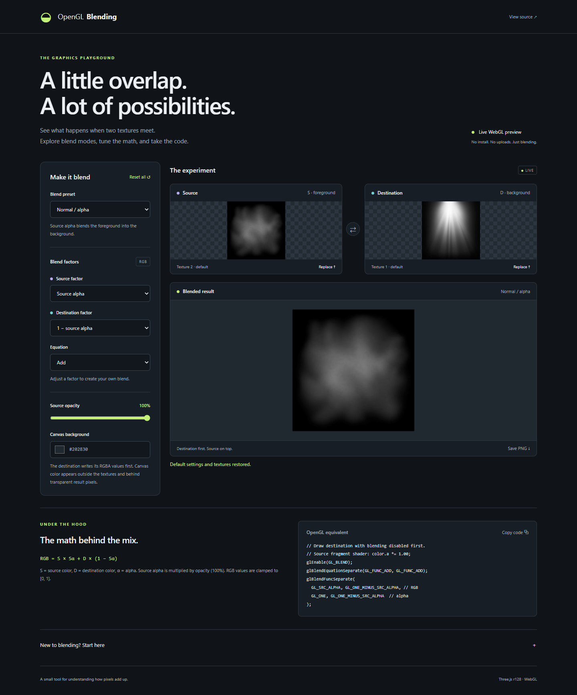

# OpenGL Blending

A visual playground for understanding how OpenGL blend factors and equations combine two textures. Built with Three.js and WebGL; runs entirely in your browser.

**[Open the playground →](https://varnholt.github.io/opengl_blending/)**



## What you can do

- Compare the **source (foreground)**, **destination (background)**, and blended result.
- Start with normal alpha, additive, multiply, subtractive, or replace presets.
- Experiment with named source/destination factors and add, subtract, reverse subtract, minimum, and maximum equations.
- Replace either texture with a local PNG, JPEG, or WebP, and swap the layers instantly.
- Change source opacity and the canvas background, then save the preview as a PNG.
- Follow the live RGB equation and copy the corresponding OpenGL calls.
- Use the controls with a keyboard or on a small screen.

Images are decoded locally and never uploaded. The app has no backend, tracking, external fonts, or runtime CDN requests. Three.js r128 is bundled in `vendor/`, including its MIT license.

## Try it

1. Open the playground and choose **Additive** to combine the bundled light textures. The default **Normal / alpha** preset is most useful with a transparent source image.
2. Use **Replace** below either input preview to load your own image (up to 20 MB). Transparent PNGs make alpha behavior easier to see.
3. Change the source opacity or click the arrow between the previews to swap the drawing order.
4. Adjust a factor or equation to enter **Custom** mode. Minimum and maximum ignore factors, so those controls are disabled while either equation is active.
5. Copy the OpenGL example or use **Save PNG** to export the result at the current preview resolution. **Reset all** restores the textures and settings.

## How blending works

The destination is drawn first with blending disabled, writing its texture's RGBA values. The source is drawn over it with the selected blend state. For the add equation:

```text
result.rgb = source.rgb × sourceFactor + destination.rgb × destinationFactor
```

Each color channel is evaluated independently. Source opacity multiplies the source alpha before blending. It does not directly scale source RGB, so its effect depends on the selected factors.

| Preset         | Source RGB factor | Destination RGB factor | Effect                                 |
| -------------- | ----------------- | ---------------------- | -------------------------------------- |
| Normal / alpha | Source alpha      | 1 − source alpha       | Alpha compositing                      |
| Additive       | Source alpha      | One                    | Add light to the destination           |
| Multiply       | Zero              | Source color           | Multiply source and destination        |
| Subtractive    | Zero              | 1 − source color       | Multiply destination by inverse source |
| Replace        | Blending disabled | Blending disabled      | Write source RGBA directly             |

All presets use the add equation. “Subtractive” follows Three.js's subtractive preset; choose **Subtract** or **Reverse subtract** in Custom mode to experiment with actual subtraction equations.

For normal blending, alpha uses `GL_ONE` and `GL_ONE_MINUS_SRC_ALPHA`, separately from RGB. Other blended presets and Custom use the selected factors for both RGB and alpha. The generated `glBlendFuncSeparate` calls show this explicitly. Independent alpha controls and constant-color/constant-alpha factors are not exposed.

### Rendering details

- Textures are fitted into the same square in the result; non-square inputs are stretched there. Input previews preserve their aspect ratio.
- Texture alpha is preserved. Transparent result pixels are composited over the selected canvas color by the browser; the exported PNG retains their alpha. The border outside the texture square is opaque canvas color.
- This is a normalized, 8-bit WebGL framebuffer. Values are clamped to `[0, 1]`. No explicit sRGB conversion or tone mapping is applied; this is a blend-state explorer rather than a color-managed image editor.
- Depth testing and depth writing are disabled, and render order is explicit. Changing blend settings affects the source only.
- Minimum and maximum require WebGL 2 or the `EXT_blend_minmax` extension. Unsupported equations are disabled.
- The OpenGL snippet assumes you draw the destination first with blending disabled, use straight-alpha textures, and apply the shown opacity in the source fragment shader. Texture setup, shader setup, viewport, and draw calls are application-specific.

## Run locally

Serve the repository over HTTP so browsers can load the textures:

```sh
git clone https://github.com/varnholt/opengl_blending.git
cd opengl_blending
python -m http.server 8937 --bind 127.0.0.1
```

Open **http://127.0.0.1:8937**. On systems where Python is named `python3`, use that command instead. No Node.js installation or build step is needed to use the app. After the files are available locally, it works without an internet connection.

## Development and checks

The source is plain HTML, CSS, and JavaScript:

```text
index.html       Page structure and accessible controls
styles.css       Responsive layout and visual theme
app.js           Texture loading, blend state, rendering, and export
resources/       Sample textures, favicon, and screenshot
vendor/          Three.js r128 and its license
tests/          Browser interaction and framebuffer pixel checks
```

Browser tests require Node.js, Python, and Chrome locally:

```sh
npm ci
npm test
```

Playwright starts a local server on port 8937. Tests cover presets, equations, reset, layer swapping, responsive overflow, decoded image uploads, invalid-image recovery, PNG export, and numeric RGBA pixel results. Software WebGL is used for reproducible rendering. In CI, Playwright uses its installed Chromium browser.

If the preview is unavailable, enable WebGL/hardware acceleration in your browser and reload. Equation and code exploration remain usable without a renderer. If textures fail to load, check that you're serving the whole repository over HTTP. When clipboard access is unavailable, **Copy code** selects the snippet for manual copying.

## References

- [OpenGL blending reference](https://registry.khronos.org/OpenGL-Refpages/gl4/html/glBlendFuncSeparate.xhtml)
- [OpenGL blend equations](https://registry.khronos.org/OpenGL-Refpages/gl4/html/glBlendEquation.xhtml)
- [Three.js r128 blend constants](https://github.com/mrdoob/three.js/blob/r128/src/constants.js)

## License

The project is released under [CC0 1.0](LICENSE). Bundled Three.js is [MIT licensed](vendor/THREE-LICENSE.txt).
